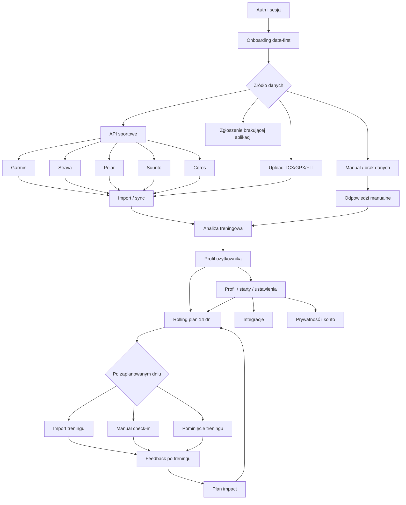
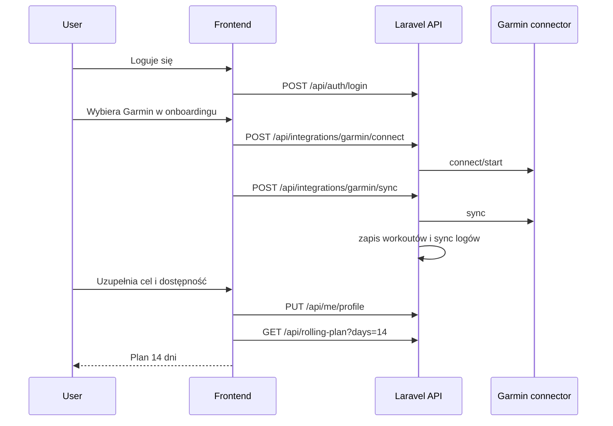
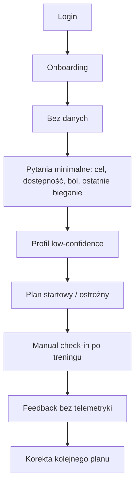
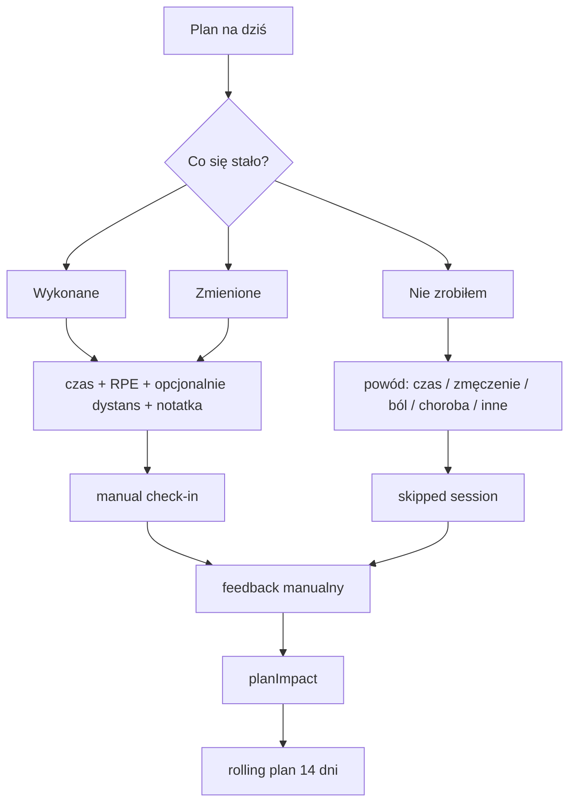

# MarcinCoach v2 - schemat funkcjonalny portalu

Stan: 2026-10-13 (aktualizacja statusów po audycie kodu; pierwotna wersja 2026-04-28).
Status dokumentu: odtworzony schemat funkcjonalny na podstawie aktywnych dokumentów i aktualnego kodu.

Ten dokument opisuje **co portal ma robić z perspektywy użytkownika i systemu**. Nie jest wireframe'em, nie jest listą zadań developerskich i nie zastępuje scenariuszy użytkownika. Ma być mapą, do której można wrócić przy decyzjach produktowych, konsultacji IT i planowaniu kolejnych pakietów MVP.

Źródła:
- `docs/status.md`
- `docs/roadmap.md`
- `docs/integrations.md`
- `docs/user-scenarios/README.md`
- `docs/user-scenarios/coverage-matrix.md`
- `docs/user-scenarios/gaps-and-next-steps.md`
- `docs/user-scenarios/it-consultation-scenarios.md`
- aktualny kod w `src/` i `backend-php/routes/api.php`

---

## 1. Definicja portalu

MarcinCoach v2 to webowy portal coachingowy dla biegaczy. Portal nie jest trackerem GPS ani social feedem. Jego główna wartość to domknięta pętla:

1. użytkownik dostarcza dane treningowe albo opisuje sytuację ręcznie,
2. system buduje profil i poziom pewności,
3. system pokazuje rolling plan 14 dni,
4. użytkownik wykonuje, modyfikuje albo pomija trening,
5. system generuje deterministyczny feedback,
6. system aktualizuje kolejne dni planu.

Najważniejsza decyzja produktowa: **manual check-in bez integracji i bez plików jest P0/core MVP**. Użytkownik bez Garmina, Stravy i TCX/FIT/GPX musi nadal móc używać aplikacji.

---

## 2. Mapa modułów funkcjonalnych

---

## 3. Role i stany użytkownika

| Rola / stan | Co widzi | Co może zrobić | Status |
|---|---|---|---|
| Anonim | ekran logowania / rejestracji / resetu hasła | zalogować się, założyć konto, zresetować hasło | zaimplementowane (`src/App.tsx`, `POST /api/auth/register`, `forgot-password`, `reset-password`); brak zmiany hasła po zalogowaniu |
| Zalogowany nowy użytkownik | onboarding | wybrać źródło danych, odpowiedzieć na pytania, pominąć | częściowo gotowe |
| Użytkownik z danymi | dashboard / plan / historia / profil / ustawienia | importować, synchronizować, odświeżać plan, oglądać historię, edytować profil i starty | zaimplementowane bazowo; GPX/FIT z UI brak |
| Użytkownik bez danych | plan startowy i manualny flow | check-in: wykonane / zmienione / pominięte, czas, RPE, ból, notatka | zaimplementowane (`ManualCheckInDialog.tsx`, `POST /api/workouts/manual-check-in`); pominięcie nie wpływa jeszcze na generator planu |
| Użytkownik Garmin | integracja Garmin | połączyć konto, zsynchronizować aktywności, wysłać trening do urządzenia | MVP działa, MFA/auto-sync brak |
| Użytkownik Strava | OAuth Strava | połączyć i synchronizować aktywności | backend partial/unknown, potrzebny prod smoke |
| Użytkownik Polar/Suunto/Coros | docelowo API sportowe; tymczasowo upload plików | połączyć API po wdrożeniu albo wgrać FIT/TCX/GPX | API planowane; fallback plikowy partial |
| Użytkownik po przerwie/kontuzji | plan ostrożny, komunikaty bezpieczeństwa | zgłosić ból, zobaczyć ograniczenia planu | częściowo gotowe; disclaimer medyczny missing |

---

## 4. Ekrany portalu

### 4.1 Ekrany aktualnie obecne

| Ekran / sekcja | Plik frontendowy | Funkcja | Status |
|---|---|---|---|
| Logowanie / rejestracja / reset hasła | `src/App.tsx`, `src/api/auth.ts` | login, logout, rejestracja, "Nie pamiętam hasła", reset z tokenem z URL, komunikat wygasłej sesji | zaimplementowane; brak zmiany hasła dla zalogowanego usera |
| Zakładki aplikacji | `src/App.tsx` | Dashboard / Plan / Historia / Profil / Ustawienia | zaimplementowane |
| Profil | `src/components/ProfileEditSection.tsx` | cele, dni treningowe, maxSessionMin, nawierzchnia, ból, sprzęt, starty A/B/C, Profile Quality Score, disclaimer medyczny | zaimplementowane |
| Manual check-in | `src/components/ManualCheckInDialog.tsx` | Wykonane / Zmienione / Nie zrobiłem, czas, dystans, RPE, samopoczucie, ból, notatka, powód pominięcia | zaimplementowane |
| Feedback po treningu | `src/components/WorkoutFeedbackPanel.tsx` | praise, deviations, conclusions, planImpact, confidence, metryki | zaimplementowane |
| Integracje | `src/components/IntegrationsSettingsSection.tsx` | status Garmin/Strava/Polar/Suunto/Coros, connect/sync/disconnect, powrót z OAuth Strava | zaimplementowane; brak formularza "Powiadom nas" |
| Onboarding | `src/components/Onboarding.tsx` | wybór źródła, Garmin/Strava/TCX/manual, pytania, skip | działa częściowo |
| Podsumowanie onboardingu | `src/components/OnboardingSummaryCard.tsx` | faktowe podsumowanie profilu po onboardingu | działa częściowo |
| Analiza treningowa | `src/components/AnalyticsSummary.tsx` | podsumowanie danych i profilu | działa częściowo |
| Garmin | `src/components/GarminSection.tsx` | connect, status, sync zakresu dat | działa MVP |
| Rolling/weekly plan | `src/components/WeeklyPlanSection.tsx` | rolling plan 14 dni, refresh, cross-training prompt, wysyłka do Garmin | działa częściowo |
| AI plan | `src/components/AiPlanSection.tsx` | dodatkowa sekcja planu AI/stub | nie jest core engine MVP |
| Upload i metryki TCX | `src/App.tsx`, `src/utils/tcxParser.ts` | wybór TCX, parsowanie, metryki, RPE, zgodność z planem | działa dla TCX; inputy plików akceptują tylko `.tcx`, GPX/FIT z UI brak (backend parsuje je po rozszerzeniu) |
| Historia treningów | `src/components/WorkoutsList.tsx` | lista, podgląd, usuwanie | działa częściowo |

### 4.2 Docelowa nawigacja MVP

Zakładki Dashboard / Plan / Historia / Profil / Ustawienia są zaimplementowane w `src/App.tsx`. Poniższa tabela opisuje docelową zawartość; elementy oznaczone "brak" nie są jeszcze w kodzie:

| Zakładka | Zawartość | Dlaczego potrzebna |
|---|---|---|
| Dashboard | ostatni feedback, check-in przy sesji planu (jest); dedykowany widok "plan na dziś" i alerty (brak) | pierwszy ekran po logowaniu |
| Plan | rolling plan 14 dni, szczegóły sesji, refresh, wysyłka do Garmin (jest); ręczna edycja sesji (brak) | główne miejsce pracy z planem |
| Historia | lista treningów, upload TCX, feedback dla treningu (jest); upload GPX/FIT (brak) | porządek wokół danych treningowych |
| Profil | cele, starty, dostępność, zdrowie, quality score, powrót do onboardingu (jest) | user musi móc poprawić dane |
| Ustawienia / Integracje | Garmin, Strava, Polar, Suunto, Coros (jest); formularz "Powiadom nas" o brakującej aplikacji (brak) | zarządzanie źródłami danych i docelowymi API sportowymi |
| Konto / Prywatność | zmiana hasła, zgody, export danych, usunięcie konta (brak) | wymagane przed publicznym launchem |

---

## 5. Główne przepływy użytkownika

### 5.1 Nowy użytkownik z Garminem

Status: połączenie i sync Garmina smoke'owane 26.04. MFA UI i auto-sync nadal są lukami.

### 5.2 Nowy użytkownik z plikami

1. Użytkownik loguje się.
2. W onboardingu wybiera pliki TCX.
3. Wgrywa wiele plików.
4. System importuje, deduplikuje i zapisuje treningi.
5. Użytkownik uzupełnia cel, datę startu, dni treningowe i ból/kontuzję.
6. System buduje analizę, confidence i rolling plan.

Status: TCX działa w UI i backendzie. GPX/FIT są backendowo parsowane po rozszerzeniu pliku, ale UI ich nie przyjmuje (brak; task EP-018), a FIT nie ma testu na realnym pliku.

### 5.3 Użytkownik bez danych

Status: onboarding manualny i plan low-data działają częściowo. Manual check-in po treningu jest zaimplementowany (model `manual_check_ins`, `POST /api/workouts/manual-check-in`, `ManualCheckInDialog.tsx`, smoke `MvpSmokeTest`). Pominięcie jest zapisywane, ale generator planu jeszcze go nie czyta.

### 5.4 Po treningu z importem

1. Użytkownik wgrywa trening albo synchronizuje integrację.
2. Trening trafia do `workouts`.
3. Użytkownik oznacza zgodność z planem: `planned`, `modified`, `unplanned`.
4. Użytkownik może podać RPE i notatkę.
5. Backend generuje feedback:
   - `POST /api/workouts/{id}/feedback/generate`,
   - `GET /api/workouts/{id}/feedback`.
6. Frontend pokazuje sekcje:
   - `praise`,
   - `deviations`,
   - `conclusions`,
   - `planImpact`,
   - confidence i metryki.
7. Plan jest odświeżany.

Status: zaimplementowane. Backend feedbacku, panel `WorkoutFeedbackPanel.tsx` i frontendowy auto-refresh rolling planu po uploadzie TCX, duplikacie, Garmin sync i check-inie są w kodzie. Auto-refresh nie jest jeszcze podpięty po Strava sync ani po usunięciu treningu.

### 5.5 Manual check-in po zaplanowanym treningu

Status: zaimplementowane (EP-007/EP-008). Diagram poniżej opisuje działający przepływ; otwarta pozostaje część "skipped → plan impact".

Minimalne pola manual check-in:
- status: `completed`, `modified`, `skipped`,
- powiązanie z planowaną sesją albo datą,
- czas w minutach,
- dystans opcjonalnie,
- RPE,
- ból/kontuzja: boolean + notatka,
- notatka użytkownika,
- powód pominięcia dla `skipped`.

Podjęte decyzje (stan kodu):
- check-in jest rekordem w osobnej tabeli `manual_check_ins`; statusy `done`/`modified` tworzą dodatkowo syntetyczny workout `MANUAL_CHECK_IN` bez `tcxRaw`, `skipped` nie tworzy treningu 0 km,
- idempotencja działa per dzień albo dzień + `plannedSessionId`,
- po check-inie frontend ponownie pobiera `GET /api/rolling-plan?days=14` (token odświeżenia); backend nie regeneruje planu sam.

Otwarte:
- generator planu (`WeeklyPlanService`, `RollingPlanController`, `PlanMemoryService`) nie czyta jeszcze check-inów ze statusem `skipped`; wpływ pominięcia na plan jest pośredni (ból z check-inu ustawia `has_current_pain`).

---

## 6. Moduły danych i logika systemowa

| Moduł | Encje / dane | Odpowiedzialność | Status |
|---|---|---|---|
| Auth | user, session token, username, `password_reset_tokens` | login, logout, rejestracja, reset hasła, token sesji, globalny interceptor 401/403 | zaimplementowane; brak zmiany hasła dla zalogowanego usera |
| Profil | `user_profiles`, typed JSON, `primaryRace`, `paceZones` | cele, zdrowie, dostępność, starty, jakość profilu | backend mocny, UI partial |
| Import treningów | `workouts`, `workout_raw_tcx`, `workout_import_events` | upload, dedupe, parsery TCX/GPX/FIT | TCX/GPX ok, FIT wymaga fixture |
| Analiza | training analysis snapshots, summary | load, intensity, confidence, profile quality | backend gotowy, UI partial |
| Plan | `training_weeks`, plan memory, rolling plan | weekly/rolling plan, adaptacje, cross-training | backend gotowy, UX partial |
| Feedback | workout feedback, compliance, alerts, `plan_snapshots` | deterministyczny feedback po treningu, plan-vs-actual | zaimplementowane (backend + `WorkoutFeedbackPanel.tsx`); alerty nie są pokazywane w UI |
| Integracje | `integration_accounts`, `integration_sync_runs` | Garmin/Strava/Polar/Suunto/Coros connect/sync/status/disconnect | Garmin MVP (bez MFA/auto-sync), Strava backend gotowy bez credentials produkcyjnych, Suunto test bridge, Polar/Coros planowane; "Powiadom nas" brak |
| Manual check-in | `manual_check_ins` + syntetyczny workout `MANUAL_CHECK_IN` | wykonane/zmienione/pominięte bez pliku | zaimplementowane; `skipped` nie wpływa jeszcze na generator planu |
| Prywatność | user consents, export, delete | RODO, zgody, prawo do danych | missing przed publicznym launchem |
| Monitoring | healthcheck, smoke E2E | pewność produkcji | healthcheck działa, smoke automation partial |

---

## 7. Kontrakty API

### 7.1 Aktualne kontrakty używane w portalu

| Obszar | Endpoint |
|---|---|
| Health | `GET /api/health` |
| Auth | `POST /api/auth/register`, `POST /api/auth/login`, `POST /api/auth/logout`, `POST /api/auth/forgot-password`, `POST /api/auth/reset-password` |
| Konto | `GET /api/me` |
| Profil | `GET /api/me/profile`, `PUT /api/me/profile` |
| Analiza | `GET /api/me/training-analysis`, `GET /api/me/onboarding-summary` |
| Plan | `GET /api/rolling-plan?days=14`, `POST /api/rolling-plan`, `GET /api/weekly-plan` |
| Workouts | `GET /api/workouts`, `GET /api/workouts/{id}`, `POST /api/workouts/upload`, `POST /api/workouts/import`, `PATCH /api/workouts/{id}/meta`, `DELETE /api/workouts/{id}` |
| Feedback | `POST /api/workouts/{id}/feedback/generate`, `GET /api/workouts/{id}/feedback` |
| Manual check-in | `POST /api/workouts/manual-check-in` (status `done`/`modified`/`skipped`) |
| Integracje (wspólne) | `GET /api/integrations/status`, `DELETE /api/integrations/{provider}`, `POST /api/integrations/suunto/sports-tracker/sync` |
| Sygnały | `GET /api/workouts/{id}/signals`, `GET /api/workouts/{id}/compliance`, `GET /api/workouts/{id}/alerts-v1` |
| Garmin | `POST /api/integrations/garmin/connect`, `GET /api/integrations/garmin/status`, `POST /api/integrations/garmin/sync`, `POST /api/integrations/garmin/workouts/send` |
| Strava | `POST /api/integrations/strava/connect`, `GET /api/integrations/strava/callback`, `POST /api/integrations/strava/sync` |
| AI/support | `GET /api/ai/plan`, `POST /api/ai/plan`, `GET /api/ai/insights`, `GET/POST /api/training-feedback-v2/*` |

### 7.2 Kontrakty do zaprojektowania

| Funkcja | Proponowany kontrakt / obszar |
|---|---|
| Zmiana hasła (brak) | `POST /api/me/password` |
| Ręczna edycja sesji planu (brak) | `PATCH /api/rolling-plan/sessions/{id}` albo podobny |
| Polar API | `POST /api/integrations/polar/connect`, `POST /api/integrations/polar/sync` |
| Suunto API | `POST /api/integrations/suunto/connect`, `POST /api/integrations/suunto/sync` |
| Coros API | `POST /api/integrations/coros/connect`, `POST /api/integrations/coros/sync` |
| Zgody (brak) | `POST /api/consents`, `GET /api/me/consents` |
| Export danych (brak) | `POST /api/me/data-export`, `GET /api/me/data-export/{id}` |
| Usunięcie konta (brak; `DELETE /api/workouts` kasuje tylko treningi) | `DELETE /api/me` |
| Brakująca aplikacja "Powiadom nas" (brak) | `POST /api/integration-requests` |

---

## 8. Status funkcjonalny według modułów

| Moduł | Status | Priorytet dalszych prac |
|---|---|---|
| Login i sesja | zaimplementowane; globalny interceptor 401/403 w `src/api/client.ts` | utrzymać |
| Rejestracja UI | zaimplementowane (`src/App.tsx`, `POST /api/auth/register`) | manual smoke produkcyjny |
| Reset hasła | zaimplementowane (API, mail, UI) | SMTP produkcyjny NIEZWERYFIKOWANY |
| Zmiana hasła po zalogowaniu | brak | P1 |
| Onboarding | działa częściowo | P0/P1 |
| Upload TCX | działa | utrzymać |
| Upload GPX/FIT w UI | backend parsuje, UI brak (accept tylko `.tcx`) | P1 (EP-018) |
| Garmin connect/sync/send | działa MVP | MFA/auto-sync P1 |
| Strava | backend + testy OAuth gotowe, callback w UI jest; credentials produkcyjne brak | prod smoke P0/P1 |
| Suunto | tymczasowy Sports Tracker test bridge (backend, domyślnie wyłączony) | oficjalne API później |
| Polar API | planowane | po stabilizacji MVP/integracji bazowych |
| Coros API | planowane | dodać do listy docelowych API sportowych |
| "Powiadom nas" o brakującej aplikacji | brak (brak endpointu i tabeli `integration_requests`) | P1 |
| Rolling plan 14 dni | działa; auto-refresh po imporcie/check-inie z frontu | ręczna edycja sesji i widok "dziś" brak |
| Feedback po treningu | zaimplementowane (backend + `WorkoutFeedbackPanel.tsx`) | alerty w UI brak |
| Manual check-in | zaimplementowane (model, API, UI, smoke) | `skipped` → wpływ na plan P0 |
| Profil i starty | zaimplementowane (`ProfileEditSection.tsx`, races CRUD, quality score) | pokazanie wpływu startu na taper/peak |
| Privacy/RODO | brak (zgody, export, usunięcie konta, audit log); disclaimer medyczny tylko w Profilu | P0 przed publicznym launch |
| Smoke/monitoring | healthcheck działa; lokalny API smoke `MvpSmokeTest`; brak produkcyjnego smoke i monitoringu | P0 |

---

## 9. MVP - minimalny komplet funkcjonalny

MVP zamkniętej bety wymaga:

1. rejestracja lub kontrolowany sposób tworzenia kont,
2. login i stabilna sesja z globalną obsługą 401,
3. onboarding data-first z możliwością skip/manual,
4. import albo sync danych,
5. rolling plan 14 dni,
6. feedback po treningu widoczny w UI,
7. manual check-in: wykonane / zmienione / pominięte,
8. plan impact po check-inie lub imporcie,
9. smoke E2E produkcji,
10. brak P0 `missing` w pętli treningowej.

MVP publiczny wymaga dodatkowo:

1. zgody przy rejestracji,
2. regulamin i polityka prywatności,
3. export danych,
4. usunięcie konta,
5. audit log zgód,
6. disclaimer medyczny przy bólu/kontuzji,
7. decyzja retencji backupów i danych zdrowotnych.

---

## 10. Najważniejsze luki P0

Zamknięte od wersji 2026-04-28: reset hasła, rejestracja UI, feedback UX, manual check-in, globalny 401 (szczegóły w `docs/status.md`).

| Luka | Dlaczego blokuje | Najbliższy krok |
|---|---|---|
| Pominięcie treningu → plan | `skipped` jest zapisywane, ale generator planu go nie czyta | konsument `manual_check_ins` w `PlanMemoryService`/`WeeklyPlanService` |
| Smoke E2E produkcji | jedyny smoke to lokalny PHPUnit `MvpSmokeTest`; brak monitoringu healthchecka | skrypt uderzający w produkcję + cron/GitHub Action |
| Upload GPX/FIT w UI | fallback plikowy dla Polar/Suunto/Coros nie działa z UI; brak fixture `.fit` | EP-018 + EP-021 |
| Strava produkcyjnie | brak credentials na IQHost (wg `docs/status.md`, 2026-04-30) | ustawić `STRAVA_*` w `.env` i wykonać live smoke |
| RODO public launch | brak zgód, exportu, usunięcia konta, audit logu | pakiet prawny + funkcje danych |

---

## 11. Kolejność wdrażania wynikająca ze schematu

1. **Higiena i monitoring**: globalny 401 (zrobione), smoke produkcyjny i healthcheck monitoring (brak).
2. **Auth dla nowych użytkowników**: rejestracja UI i reset hasła (zrobione), zmiana hasła po zalogowaniu (brak).
3. **Pętla treningowa MVP**: feedback UX, auto-refresh planu, manual check-in (zrobione); `skipped` → plan impact (brak).
4. **Profil i nawigacja**: zakładki, profil, starty, powrót do onboardingu (zrobione).
5. **RODO przed publicznym launch**: zgody, export, delete, audit (brak); disclaimer tylko w Profilu.
6. **Integracje i jakość danych**: Strava prod credentials, Garmin auto-sync/MFA, GPX/FIT UI, korekta sportu, "Powiadom nas" (brak).

---

## 12. Zasady produktowe do pilnowania

1. Backend deterministyczny jest źródłem prawdy dla planu i feedbacku.
2. AI nie jest silnikiem MVP; może pomagać, ale nie może ukrywać braku logiki.
3. Mała próbka danych oznacza niski confidence, nie udawaną precyzję.
4. Skip onboardingu nie może karać użytkownika.
5. Manual check-in jest normalną ścieżką, nie awaryjną protezą.
6. Cross-training jest pełnoprawnym sygnałem treningowym.
7. Każda integracja musi mieć fallback w postaci pliku albo manualnego wpisu.
8. Ból/kontuzja to sygnał ostrożności treningowej, nie porada medyczna.
9. Frontendu nie budujemy na IQHost: lokalnie `npm run build`, potem `.\deploy-front.ps1`.

---

## 13. Co ten schemat celowo pomija

- Pixel-perfect UI i layouty.
- Szczegółową specyfikację pól każdego endpointu.
- Historyczne plany Node/Nest.
- Płatności, social feed, LiveTrack, pogodę/smog, HRV/sen/readiness.
- Publiczne treści marketingowe.

Te tematy są poza aktualnym MVP albo mają osobne dokumenty.

---

## 14. Jak aktualizować dokument

Po każdej większej zmianie:

1. zaktualizować status w odpowiednim pliku scenariuszy,
2. zaktualizować `docs/user-scenarios/coverage-matrix.md`,
3. jeśli funkcja została ukończona, dopisać ją do `docs/status.md`,
4. jeśli zmienia się kształt portalu albo przepływ użytkownika, zaktualizować ten schemat.

Ten dokument ma pozostać krótki względem pełnych scenariuszy. Gdy pojawia się nowy edge case, właściwym miejscem jest `docs/user-scenarios/`, a tutaj tylko mapa modułów i główna pętla.
